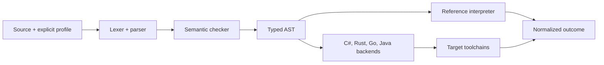

# h#

**One semantic core. Your notation. C#, Go, Rust, and Java output.**

h# is a small programming language with a shared semantic core, declarative per-user keyword syntax, and source generation for four target ecosystems. Programs are parsed and checked once, then executed by a reference interpreter and translated into ordinary C#, Go, Rust, and Java projects that the target toolchains compile themselves.

The proof of concept is complete and verified: **29 conformance cases × 4 profiles × 4 targets = 464 real target executions**, plus 27 negative cases, 19 unit tests, and a bridge protocol test.

- **Language:** h# (aliases: `hsharp`, `hcharp`, `hs`)
- **CLI:** `hs` (aliases: `hsharp`, `hcharp`)
- **Source files:** `.hs`
- **Status:** POC 0.1 — see [`ROADMAP.md`](ROADMAP.md)

---

## Why h#

- **Shared meaning.** Types, evaluation order, checked arithmetic, and failure behavior come from one specification, not four independent implementations.
- **Personal notation.** A profile changes the seven keyword roles without changing the program's meaning. Profiles are validated JSON data, never executable grammar.
- **Four real outputs.** Generated projects are compiled and executed by .NET, Cargo, Go, and `javac`. Nothing is simulated.
- **Explicit failures.** Overflow is detected after every operation and reported as `E_OVERFLOW` with the failing source node.
- **Lossless syntax conversion.** Conversion rewrites keyword tokens only; comments, identifiers, whitespace, and the rest of the text survive.

## Example

Canonical source:

```text
fn calculate(x: i32, bonus: bool) -> i32 {
    let base: i32 = x * 3;

    if bonus {
        return base + 2;
    }

    return base;
}
```

The same program in `profiles/my-syntax.json`:

```text
function calculate(x: i32, bonus: bool) -> i32 {
    value base: i32 = x * 3;

    when bonus {
        give base + 2;
    }

    give base;
}
```

`calculate(10, true)` produces:

```json
{"status":"ok","type":"i32","value":32}
```

The reference interpreter and all four generated programs return the same result.

## Status

| Area | State |
|---|---|
| Core language | `i32`, `bool`, functions, calls, immutable locals, `if`/`else`, returns |
| Semantics | Checked arithmetic, left-to-right evaluation, short-circuit `&&`/`||` |
| Static checks | Types, arity, names, missing returns, acyclic call graph, chained comparisons |
| Profiles | Keyword customization, validation, token-aware conversion, comment preservation |
| Personal workflow | Export, edit, reimport, stale-base and changed-profile detection, manifest refresh |
| Backends | C#, Go, Rust, Java — generated, compiled, executed |
| Verification | 29 positive cases, 27 negative cases, 19 unit tests + bridge test, 0 failed/blocked |
| Editor support | Visual Studio Code extension with live diagnostics and generated-code preview |
| Performance | Sub-millisecond warm analyze + four-target generation; a few ms bridge round-trip |
| Documentation | Core spec, grammar, profiles, protocol, decisions, limitations, verification, roadmap |

## Quick start

Pinned versions and setup details are in [`docs/getting-started.md`](docs/getting-started.md).

```powershell
npm install
npm run build

node dist/cli/index.js check examples/calculate.hs
node dist/cli/index.js demo
node dist/cli/index.js test --all-targets
```

Install the command once with `npm link`; `hs`, `hsharp`, and `hcharp` all invoke the same CLI.

```powershell
hs doctor
hs check examples/calculate.hs
hs build examples/calculate.hs --target rust --entry calculate --run --args 10,true
```

## Commands

| Command | Purpose |
|---|---|
| `hs check <file>` | Parse and check; print located diagnostics |
| `hs build <file> --target <t>` | Generate a target project; `--run` compiles and executes it |
| `hs syntax export <canonical> --profile <p> --out <personal>` | Write personal notation plus a fingerprint manifest |
| `hs syntax import <personal>` | Validate the base/profile, diff, and reimport an edit |
| `hs test --all-targets` | Run the complete conformance suite and write reports |
| `hs doctor` | Detect and version-check all four toolchains |
| `hs demo` | Run export → edit → reimport → reference + four targets |
| `hs bridge` | Line-delimited JSON over stdio for editor integrations |

Canonical source is always interpreted with the standard profile. A personal profile is selected explicitly; there is no implicit local preference.

## Editor support

A Visual Studio Code extension is included under [`editors/vscode`](editors/vscode/README.md). It bundles the compiler into the extension host and provides:

- profile-aware syntax highlighting;
- live diagnostics with source locations;
- a **real-time generated-code preview** for C#, Rust, Go, and Java;
- target switching without recompiling;
- status-bar analysis timing and error count.

Build and install it from the repository root:

```powershell
npm install
npm run vscode:install
```

This packages `build/vscode/hsharp-vscode.vsix` and installs it. If you install manually with `code --install-extension`, VS Code 1.143 may print an upstream `DEP0169 url.parse()` warning from its own CLI; `npm run vscode:install` suppresses that warning, and the h# bundle does not use `url.parse`.

Open any `.hs` file, then run **h#: Show Generated Code** from the command palette or use the editor-title button.

The extension imports the same analyzer used by the CLI, so no external `hs` process is needed. Measured warm latency is **sub-millisecond** for analysis + four-target generation. See [`docs/performance.md`](docs/performance.md).

## Website

A static showcase and documentation site lives in [`site/`](site/README.md). It includes:

- a live syntax-profile composer;
- generated target inspection for C#, Rust, Go, and Java;
- overflow and short-circuit boundary labs;
- an export/reimport conflict walkthrough;
- a filterable conformance explorer;
- precise docs for semantics, grammar, profiles, CLI, targets, and verification;
- full English, French, and Japanese routes with a language switcher.

```powershell
npm --prefix site install
npm run site:dev
npm run site:build
# output: site/dist/
```

All interactive demos are client-side illustrations; no h# program is executed in the browser.

## How it works



Key properties:

- Generated code depends on the typed AST, not source spelling. All profiles produce the same target project.
- Target names come only from compiler-assigned IDs (`f1`, `v2`, `tN`), so source names cannot collide with host reserved words.
- Every generated function returns an internal success/failure record. Checked arithmetic propagates failures to the execution boundary.
- Generated programs do not call the TypeScript interpreter.

More detail: [`spec/core.md`](spec/core.md), [`spec/profiles.md`](spec/profiles.md), [`spec/code-generation.md`](spec/code-generation.md).

## Generated projects

| Target | Files | Verification |
|---|---|---|
| C# | `HsProgram.csproj`, `Program.cs` | `dotnet build` + `dotnet bin/HsProgram.dll` |
| Rust | `Cargo.toml`, `src/main.rs` | `cargo build --release --offline` + binary |
| Go | `go.mod`, `main.go` | `go build` + binary |
| Java | `HsProgram.java` | `javac` + `java -cp bin HsProgram` |

Generated projects are written under `build/` by default and contain no external dependencies.

## Verification

```powershell
npm test
# or
hs test --all-targets
```

- 19 unit tests: profiles, conversion, semantics, manifest lifecycle, diagnostics.
- Bridge protocol test: ping, analyze with four targets, invalid syntax, malformed request, shutdown.
- 29 positive cases over 4 profiles and 4 targets.
- 27 negative program/profile cases.
- Independent expected outcomes, pinned overflow node IDs, process exit-status checks.
- Performance budgets enforced by `npm run bench`; results in [`reports/benchmark.json`](reports/benchmark.json).
- Reports: [`reports/conformance.md`](reports/conformance.md), [`reports/conformance.json`](reports/conformance.json), [`reports/environment.json`](reports/environment.json), [`reports/benchmark.json`](reports/benchmark.json).

A missing or too-old toolchain marks a target **blocked** and makes the suite exit 2. It never reports a pass. `hs test --quick` is explicitly labelled interpreter-only.

Full evidence: [`docs/verification.md`](docs/verification.md).

## Personal syntax workflow

```powershell
hs syntax export examples/calculate.hs `
  --profile profiles/my-syntax.json `
  --out local/calculate.hs

# edit local/calculate.hs in the personal notation
hs check local/calculate.hs --profile profiles/my-syntax.json
hs syntax import local/calculate.hs
```

The export manifest records SHA-256 fingerprints for the canonical file, profile, and personal file. Reimport rejects:

- a canonical file changed after export (`E_IMPORT_STALE_BASE`);
- a changed profile (`E_IMPORT_PROFILE_CHANGED`);
- a manifest belonging to another personal file;
- invalid or unchecked personal source.

On success the manifest is refreshed, so the edit/import cycle can continue. See [`spec/profiles.md`](spec/profiles.md).

## Repository layout

| Location | Contents |
|---|---|
| `spec/` | Core semantics, grammar, profiles, execution protocol, code generation |
| `src/contracts/` | AST, diagnostics, tokens, outcomes, shared interfaces |
| `src/frontend/` | Lexer, parser, profile validation, keyword conversion |
| `src/semantic/` | Scopes, types, return analysis, call-graph checks, entry selection |
| `src/reference/` | BigInt reference interpreter |
| `src/backends/` | C#, Rust, Go, Java generators |
| `src/harness/` | Toolchain detection, generated-project build/run |
| `src/testing/` | Unit tests, conformance runner, reports |
| `src/cli/` | `hs` command line |
| `src/service/` | Fast in-process analyzer and editor bridge |
| `editors/vscode/` | Visual Studio Code extension |
| `site/` | Static showcase site, docs, and interactive demos |
| `profiles/` | Standard, supplied personal, and user-created profiles |
| `examples/` | Demonstration programs |
| `tests/conformance/` | Positive/negative programs and independent expectations |
| `tests/negative/` | Profiles that must be rejected |
| `reports/` | Environment and conformance evidence |
| `docs/` | Getting started, decisions, verification, acceptance, limitations |
| `ROADMAP.md` | Phase plan and exit evidence |

## Verification commands

```text
npm test             # unit, editor typecheck, bridge, conformance
npm run test:property # seeded generated programs against the reference and all targets
npm run verify        # both suites, in order
```

Property runs write `reports/property.json` and `reports/property.md`. A failure is reduced by
deleting source lines while the divergence remains reproducible.

## Roadmap

| Phase | Theme |
|---|---|
| 0.2 | Verification hardening: seeded property tests, cross-platform CI |
| 0.3 | Records, strings, lists, variants, `Option`, `Result` |
| 0.4 | Loops, recursion, controlled mutation, generics |
| 0.5 | Multi-file modules and host-ecosystem embedding |
| 0.6 | Syntax families, CST/printer, LSP, continuous personalized editing |
| 0.7 | Async and concurrency |
| 1.0 | Extensions, measured performance, compatibility policy |

See [`ROADMAP.md`](ROADMAP.md) for dependencies, acceptance evidence, risks, and non-goals.

## Documentation

- [Roadmap](ROADMAP.md)
- [Getting started](docs/getting-started.md)
- [Core semantics](spec/core.md)
- [Grammar](spec/grammar.md)
- [Profiles and export/import](spec/profiles.md)
- [Execution protocol](spec/execution-protocol.md)
- [Code generation](spec/code-generation.md)
- [Design decisions](docs/decisions.md)
- [Performance and real-time analysis](docs/performance.md)
- [Visual Studio Code extension](editors/vscode/README.md)
- [Website](site/README.md)
- [Verification evidence](docs/verification.md)
- [POC acceptance](docs/acceptance.md)
- [Limitations and next steps](docs/limitations.md)
- [Agent handoffs and reviews](docs/handoffs.md)
- [Original execution plan](hsharp-execution-plan.md)

## Limitations

The POC intentionally covers a small core: no strings, collections, records, loops, recursion, mutation, modules, generics, I/O, or concurrency. Profiles customize keywords only; braces and operators are fixed. Export/import is batch-oriented, not continuous editor integration. Verification currently runs on Windows x64.

The `.hs` extension is also used by Haskell, so editor file associations may need configuration.

See [`docs/limitations.md`](docs/limitations.md) for the complete list and prioritized next work.
