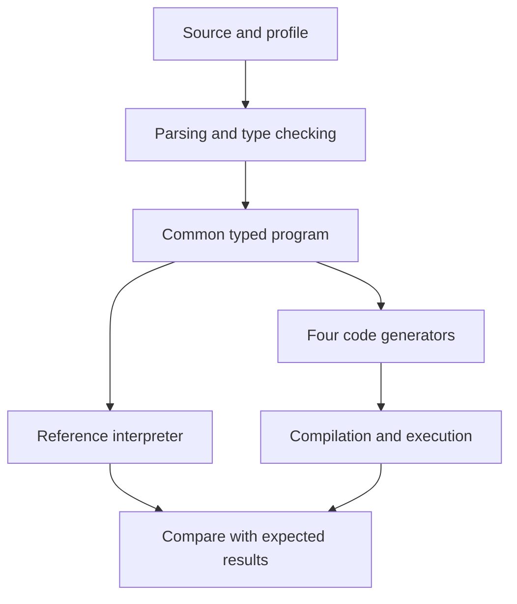

# Uni: AI Agent Execution Plan

## Purpose

Build a programming language with a shared semantic core, customizable syntax for each user, and source-code generation for **C#, Go, Rust, and Java**.

**The first objective is a small, executable proof of concept (POC), delivered through parallel agent work and verified with all four target toolchains.**

“Uni” is a provisional name. Commands, file layouts, and configuration examples in this document describe interfaces to implement.

AI agents build and verify the compiler. Once implemented, the compiler applies deterministic, versioned rules; ordinary compilation does not require a model call.

This plan uses dependency-based milestones and observable acceptance criteria. It does not assume a fixed month-by-month schedule or guaranteed speedups from adding agents.

## Contents

1. [Product definition and proof of success](#1-product-definition-and-proof-of-success)
2. [Minimal language core](#2-minimal-language-core)
3. [Per-user syntax customization](#3-per-user-syntax-customization)
4. [Canonical source and collaboration](#4-canonical-source-and-collaboration)
5. [Compiler architecture](#5-compiler-architecture)
6. [The four target backends](#6-the-four-target-backends)
7. [AI agent organization](#7-ai-agent-organization)
8. [Execution work packages](#8-execution-work-packages)
9. [Verification strategy](#9-verification-strategy)
10. [POC acceptance and delivery](#10-poc-acceptance-and-delivery)
11. [Future development](#11-future-development)
12. [Obstacles and design responses](#12-obstacles-and-design-responses)
13. [Milestones and execution management](#13-milestones-and-execution-management)
14. [Copyable orchestrator brief](#14-copyable-orchestrator-brief)
15. [Technical references](#15-technical-references)

## 1. Product Definition and Proof of Success

### 1.1 Intended behavior

A developer writes a program using a selected syntax profile. The compiler understands and checks the program, then generates a C#, Go, Rust, or Java implementation.

The product has four parts:

| Part | Responsibility |
|---|---|
| Semantic core | Defines types, operations, functions, errors, and execution rules |
| Syntax profiles | Provide different notations for the same language constructs |
| Code generators | Produce source code and project files for the four targets |
| Development tools | Check, build, convert syntax, report diagnostics, and verify conformity |

**Syntax may vary between users. Program meaning remains shared.**

The initial architecture is source-to-source compilation: Uni source is parsed, checked, and translated into a target project that the target's own tools compile.

Importing existing projects and accessing target-specific libraries are separate capabilities with their own future work packages.

### 1.2 End-to-end demonstration

A user must be able to:

1. Write a function using the standard syntax.
2. Create a personal keyword profile.
3. Export the program into that notation.
4. Edit the personal version.
5. Reimport the change into the canonical source.
6. Generate, compile, and execute all four target implementations.
7. Obtain the expected value or normalized error.
8. Locate diagnostics in the original source.

Standard syntax:

```text
fn calculate(x: i32, bonus: bool) -> i32 {
    let base: i32 = x * 3;

    if bonus {
        return base + 2;
    }

    return base;
}
```

Personal syntax:

```text
function calculate(x: i32, bonus: bool) -> i32 {
    value base: i32 = x * 3;

    when bonus {
        give base + 2;
    }

    give base;
}
```

For `x = 10` and `bonus = true`, the expected result is `32` in both syntaxes and on all four targets.

A second example includes a call between functions. A third intentionally produces an arithmetic overflow.

The user must also be able to invent a third profile that was not hard-coded into the compiler.

## 2. Minimal Language Core

### 2.1 POC scope

| Feature | Initial decision |
|---|---|
| Types | `i32` and `bool` |
| Functions | Named functions with explicitly typed parameters and return values |
| Calls | Calls to functions in the same program, with checked arity |
| Variables | Immutable local bindings with explicit type annotations |
| Scope | Lexical; redeclaring a currently visible name is rejected |
| Conditions | `if` and `else`; conditions must be Boolean |
| Returns | Every function path returns the declared type |
| Arithmetic | Checked addition, subtraction, multiplication, and negation |
| Comparisons | Equality for matching types; ordering for `i32` |
| Boolean operations | `!`, `&&`, and `||` |
| Comments | `//` line comments preserved by syntax conversion |
| Execution entry | A function selected explicitly by the execution harness |

Defer strings, collections, objects, loops, recursion, floating-point numbers, division, I/O, generics, external libraries, and asynchronous functions.

This small core makes the initial correctness claim bounded and testable.

### 2.2 Common semantic rules

1. `i32` represents integers from −2,147,483,648 through 2,147,483,647.
2. Operands and function arguments are evaluated from left to right.
3. `false && expression` and `true || expression` do not evaluate the right-hand side.
4. Each arithmetic operation checks its result independently.
5. An arithmetic failure interrupts the computation and propagates to the execution boundary.
6. No implicit conversion exists between integers and Booleans.
7. All branches are checked statically, including branches that will not execute.
8. The call graph must be acyclic. Direct and indirect recursion are rejected.
9. Names are case-sensitive. POC identifiers use ASCII letters, digits, and underscores, with no leading digit.
10. Operator precedence is fixed, from highest to lowest: calls, unary operators, multiplication, addition/subtraction, ordering comparisons, equality, `&&`, then `||`.
11. Arithmetic binary operators at the same precedence associate to the left. Parentheses change grouping. Chained comparisons are rejected.

Accept the special literal `-2147483648`. Reject positive `2147483648` as an out-of-range literal. Negating a variable that contains the minimum value produces an execution failure.

The POC performs no constant-expression optimization. An arithmetic operation between valid values that exceeds the range is an execution error, even when its operands are literals.

Overflow handling must be explicit: Go permits signed-integer overflow without a panic; Rust provides checked operations; C# distinguishes checked and unchecked arithmetic contexts. The new language must impose its own rule. See the [Go specification](https://go.dev/ref/spec#Integer_overflow), [Rust checked addition](https://doc.rust-lang.org/std/primitive.i32.html#method.checked_add), and [C# overflow documentation](https://learn.microsoft.com/en-us/dotnet/csharp/language-reference/statements/checked-and-unchecked).

### 2.3 Errors and observable results

Define a shared technical result protocol:

```text
Outcome =
    Success(type, value)
  | Failure(code, sourceNode)
```

The initial arithmetic failure code is `E_OVERFLOW`.

Syntax, type, name-resolution, missing-return, and profile errors are reported before code generation.

This protocol is internal to the compiler, generated projects, and test harness. User-facing `Result<T, E>` is a later language feature.

Keep infrastructure failures separate from program failures. A missing target compiler produces a **blocked** verification result, never a passing result.

## 3. Per-User Syntax Customization

### 3.1 Declarative keyword profiles

Each user can create a configuration file:

```json
{
  "id": "my-syntax",
  "version": "1",
  "core": "0.1",
  "family": "braces",
  "keywords": {
    "fn": "function",
    "let": "value",
    "if": "when",
    "else": "otherwise",
    "return": "give",
    "true": "yes",
    "false": "no"
  }
}
```

The POC allows keyword customization. Type names, operators, precedence, braces, parentheses, and semicolons remain fixed by the initial syntax family.

Function and variable names belong to the program; the profile does not translate them.

The profile used to read a file is selected explicitly. A local preference must never silently change how canonical source is interpreted.

### 3.2 Profile validation

Validate:

- Every required keyword role is present.
- Different roles use different words.
- Every word matches the allowed lexical form.
- Core and profile versions are compatible.
- Aliases do not collide with program identifiers or reserved core words.
- Unknown configuration options are rejected.

A canonical keyword may retain its own role; it cannot be reassigned to a different role. Active aliases and canonical keywords are reserved within the profile.

Profiles are data. They contain no executable code or arbitrary grammar in the POC.

### 3.3 Token-aware conversion

Convert recognized tokens, rather than performing global substring replacement.

Changing the keyword `return` to `give` must not change:

- An identifier containing the same characters.
- A comment containing the word.
- Later, the contents of a string literal.

For this first lexical level, changing keyword tokens while preserving the remaining text is sufficient.

### 3.4 Future levels of customization

| Level | Added freedom | Required evidence |
|---|---|---|
| POC | User-selected keywords | Two supplied profiles and one user-created profile work |
| Syntax families | Braces, explicit block markers, then indentation | Same AST and reliable comment preservation |
| Advanced notation | Alternative call forms or declarative constructs | Explicit ambiguity and precedence rules |
| Extensions | Macros or grammar modules | Controlled expansion, diagnostics, and versioning |
| Personalized editor | Continuous display in each user's notation | Invalid drafts, cursor positions, and shared edits are handled |

A new notation either expresses an existing construct or explicitly introduces a language extension. A cosmetic profile must not introduce hidden semantic differences.

## 4. Canonical Source and Collaboration

Keep a readable, canonical text representation in the repository. A personal source file is a local representation of that program.

For the POC, implement explicit export, editing, and reimport. Continuous personalized editing is a separate later capability.

### 4.1 Export

The export command:

1. Reads the canonical program.
2. Validates the selected profile.
3. Produces the personal source file.
4. Writes an associated manifest.

The manifest records:

- Canonical file identity and content fingerprint.
- Profile identity and content fingerprint.
- Core version.
- Compiler version.

### 4.2 Reimport

The reimport command:

1. Confirms that the canonical source still matches the exported base.
2. Confirms that the profile has not changed.
3. Parses and checks the edited personal source.
4. Produces the canonical-source diff.
5. Applies the change when validation succeeds.

A stale base or changed profile causes an explicit rejection with an actionable explanation.

For the POC, detecting conflicts is sufficient. Automatic merging is future work.

### 4.3 Preservation guarantees

Changing profiles must preserve the normalized AST: the program structure, ignoring locations and comments.

Verify comment preservation separately.

Token-based conversion can preserve the remaining source text for keyword-only profiles. Future syntax families will require a concrete syntax tree or a more comprehensive printing strategy.

Continuous integration builds the canonical source using declared versions. A strictly personal profile is therefore not required to build the shared project.

## 5. Compiler Architecture

### 5.1 Initial technology choices

| Component | Proposed choice |
|---|---|
| Compiler implementation | TypeScript |
| Lexer and parser | Chevrotain |
| Common representation | Typed AST |
| Behavioral reference | Small independent interpreter |
| User interface | CLI |
| Profile format | JSON |
| Final verification | Real compilation and execution for each target |

Chevrotain provides a JavaScript parsing toolkit with separate syntax and semantics responsibilities. See its [documentation](https://chevrotain.io/docs/).

The reference interpreter can use `BigInt` for arithmetic and check the `i32` range after every operation. Target backends implement their own checked arithmetic. This implementation diversity complements independently specified expected results. See the [ECMAScript BigInt specification](https://tc39.es/ecma262/multipage/ecmascript-data-types-and-values.html#sec-ecmascript-language-types-bigint-type).

Record and pin the Node, TypeScript, dependency, and target-toolchain versions actually used. Avoid a moving dependency on unspecified “latest” versions.

### 5.2 Processing pipeline



### 5.3 Representations and responsibilities

| Component | Input | Output |
|---|---|---|
| Lexer and parser | Source plus explicit profile | Tokens, source AST, and positions |
| Semantic checker | Source AST | Resolved symbols, types, and diagnostics |
| Typed representation | Checked program | Shared representation for backends |
| Reference interpreter | Typed program and arguments | Reference outcome |
| Backend | Typed program and target | Sources, minimal runtime, and project files |
| Syntax converter | Tokens and source/target profiles | Converted source and manifest |
| Conformance runner | Cases, expectations, and generated projects | Report per profile and target |

The source AST represents the program and supports diagnostics and editing. The typed representation, often called an IR, adds information required by code generation.

For the POC, the IR can be a typed AST. A complex optimization framework is unnecessary.

Keep tokens, comments, and positions in the source layer. Syntax conversion and code generation have different responsibilities.

### 5.4 Shared interfaces

```text
parse(text, profile) -> SourceProgram | Diagnostics

check(sourceProgram) -> TypedProgram | Diagnostics

evaluate(typedProgram, entry, arguments) -> Outcome

emit(typedProgram, target) -> GeneratedProject

convert(sourceTokens, fromProfile, toProfile) -> SourceText

runConformance(cases, targets) -> Report
```

The orchestrator supplies hand-built source and typed-program fixtures. Backend agents start against these fixtures before the parser is finished.

Every symbol receives an internal identifier. Generate deterministic target names from these identifiers to avoid collisions with host-language reserved words.

Backends emit known constructs from typed data. They never insert arbitrary profile text as host code.

### 5.5 Proposed repository layout

| Location | Contents |
|---|---|
| `spec/` | Core rules, grammar, profiles, and error conventions |
| `src/contracts/` | Shared AST, IR, diagnostics, and interfaces |
| `src/frontend/` | Lexer, parser, and syntax conversion |
| `src/semantic/` | Scopes, types, call validation, and return checks |
| `src/reference/` | Reference interpreter |
| `src/backends/` | C#, Rust, Go, and Java generators |
| `src/cli/` | User commands |
| `profiles/` | Supplied and example profiles |
| `tests/conformance/` | Cases and independently defined expectations |
| `tests/negative/` | Programs and profiles that must be rejected |
| `examples/` | Demonstration programs |
| `docs/` | Decisions, limitations, and follow-up work |

These are proposed project paths, not claims that the compiler has already been implemented.

## 6. The Four Target Backends

### 6.1 Generated projects

| Target | Integer value representation | Generated project | Verification |
|---|---|---|---|
| C# | `int` | Source files and `.csproj` | Build and execute with .NET |
| Rust | `i32` | Source files and `Cargo.toml` | Build and execute with Cargo |
| Go | `int32` | Source files and `go.mod` | Build and execute with Go |
| Java | `int` | Source files and compilation command | Run `javac`, then `java` |

### 6.2 Common checked arithmetic

A simple strategy for POC operations is:

1. Widen `i32` operands to signed 64-bit integers.
2. Perform the operation.
3. Check whether the result fits in `i32`.
4. Narrow the valid result or return `E_OVERFLOW`.

Addition, subtraction, multiplication, and negation of `i32` operands fit in this 64-bit intermediate.

Check each operation separately. Checking only the final result of an entire expression can change the specified behavior.

Platform checked primitives are also acceptable when their failure behavior is normalized.

### 6.3 Evaluation and error propagation

Each generated function propagates an internal success/failure result. Rust may represent this with `Result`; another target may use an equivalent structure.

This internal convention does not require user-facing `Result` syntax in the initial language.

Introduce temporaries where necessary to enforce evaluation order. Generate conditional control flow for short-circuit operators, so the right operand is not evaluated prematurely.

### 6.4 Execution protocol

The harness converts host results into a common representation:

```json
{"status":"ok","type":"i32","value":32}
```

Keep build logs and diagnostics separate from machine-readable outcomes.

Generated programs contain translated computations. Their execution does not depend on calling the TypeScript reference interpreter.

Start with Rust and C# to exercise two different environments early. Add Go and Java as soon as the common interfaces and first integrated chain are stable. The complete POC requires all four targets.

## 7. AI Agent Organization

Start with **one orchestrator and three implementation agents**. Add agents when additional independent work packages and stable interfaces exist.

| Agent | Initial ownership | Possible next assignment |
|---|---|---|
| Orchestrator | Specification, shared contracts, expected results, integration, CLI, and first C# backend | Final report and demonstration |
| Agent A | Frontend, profiles, export, and reimport | Go backend |
| Agent B | Semantic checks, reference interpreter, and diagnostics | Cross-review and edge cases |
| Agent C | Rust backend using typed fixtures | Java backend |

The orchestrator builds the C# output after establishing the contracts and minimal harness. Reassign it if another available agent can unblock integration sooner.

### Collaboration rules

- Use an isolated worktree or checkout for each workstream.
- Assign one owner to each shared file at a time.
- Route AST, IR, and semantic changes through the orchestrator.
- Integrate small increments as soon as they unlock useful behavior.
- Keep expected results independent from generated outputs.
- Cross-review backends and syntax conversions.
- Reduce every divergence to a minimal reproducible example.
- Fix genuinely ambiguous specifications explicitly; never silently change expectations to hide a defect.

Every agent handoff states:

1. What behavior works.
2. What verification actually ran.
3. What limitations remain.
4. What blocks the next step.

A work package is complete when its behavior works in the integrated system.

## 8. Execution Work Packages

### Package 0 — Reproducible environment

**Work**

- Initialize the repository.
- Record tool versions.
- Build and execute a minimal program in every target.
- Prepare the verification entry point.
- Pin the versions actually used.

**Deliverable:** a documented environment and the status of all four toolchains.

**Exit criterion:** toolchains work, or remaining blockers are identified and assigned while independent work continues.

### Package 1 — Shared contracts and fixtures

**Work**

- Define the core semantics and grammar.
- Define profile validation rules.
- Define source and typed representations.
- Define diagnostics and execution outcomes.
- Create hand-built AST/IR fixtures.
- Establish initial expected results directly from the specification.

**Deliverable:** a compact contract that agents can implement without inventing incompatible rules.

**Exit criterion:** frontend, semantic, interpreter, and backend work can begin independently.

### Package 2 — First complete execution path

**Parallel work**

- Agent A: lexer, parser, standard profile, and personal profile.
- Agent B: names, types, return checks, and reference interpreter.
- Agent C: Rust generation from typed fixtures.
- Orchestrator: minimal harness, C# generation, and integration.

**Deliverable:** a real source program executes through the reference interpreter and two compiled targets.

**Exit criterion:** a program with a function, local variable, and conditional produces the expected outcome in C# and Rust; an overflow is reported correctly.

Prioritize this package over adding language features. It reveals contract problems early.

### Package 3 — All four outputs

**Work**

- Implement Go generation.
- Implement Java generation.
- Integrate compilation and execution.
- Normalize target outcomes.
- Run the existing corpus against all four targets.

**Deliverable:** one command generates, compiles, runs, and compares all targets.

**Exit criterion:** existing cases pass across all four environments without manually editing generated code.

### Package 4 — Usable personal syntax

Prepare this work during frontend development; finish it as dependencies become available.

**Work**

- Complete profile validation.
- Implement export and its manifest.
- Implement reimport.
- Preserve comments and identifiers.
- Detect profile collisions, changed profiles, and stale source bases.

**Deliverable:** a user creates a third profile, edits a personal representation, and reimports the change.

**Exit criterion:** the modified program behaves consistently on all four targets, comments survive, and stale reimports are rejected.

### Package 5 — Verified POC delivery

**Work**

- Run nominal and boundary cases.
- Perform independent cross-review.
- Verify the workflow from a clean environment.
- Write the getting-started guide.
- Generate the conformance report.
- Document limitations and next priorities.

**Deliverable:** repository, CLI, examples, profiles, verification evidence, and known limitations.

**Exit criterion:** every acceptance item in Section 10 is satisfied.

Packages describe dependencies, not fixed calendar periods. Tasks start when their inputs are stable. Typed fixtures allow backend work before the entire analysis pipeline is ready.

## 9. Verification Strategy

Start with roughly 20–30 small programs plus invalid configurations. This is a planning guide; coverage of semantic rules matters more than test count.

### 9.1 Essential cases

| Case | Expected outcome |
|---|---|
| `2 + 3 * 4` | `14` |
| `(2 + 3) * 4` | `20` |
| `10 - (4 - 1)` | `7` |
| Return the minimum or maximum `i32` | Success |
| `x + 1` with maximum `x` | `E_OVERFLOW` |
| `x - 1` with minimum `x` | `E_OVERFLOW` |
| `x * -1` with minimum `x` | `E_OVERFLOW` |
| `-x` with minimum `x` | `E_OVERFLOW` |
| `false && ((x + 1) > 0)` with maximum `x` | `false` without overflow |
| Function calling another function | Specified value |
| Integer supplied to a Boolean parameter | Rejected before generation |
| Wrong argument count | Rejected before generation |
| Unknown name | Rejected before generation |
| Missing return on a reachable path | Rejected before generation |
| Cycle in the call graph | Rejected before generation |
| Two keyword roles with the same alias | Profile rejected |
| Valid Uni name reserved by a target | Valid generated name and unchanged behavior |
| Comment containing a keyword | Comment preserved |
| Canonical source changed after export | Reimport conflict reported |

Also cover malformed syntax, non-Boolean conditions, incompatible versions, and the special minimum-integer literal rule.

### 9.2 Three complementary checks

**Structural equivalence:** the same program under different profiles produces the same normalized AST.

**Behavioral conformity:** the reference interpreter and each compiled target match independently specified values and error codes.

**Round-trip preservation:** exporting and reimporting without edits preserves the program and comments.

At least two profiles multiplied by four targets gives eight execution combinations per valid case. A third user-created profile also exercises the end-to-end workflow.

Compare values and error codes across profiles. Test source locations separately because textual positions change with notation.

The interpreter is not the sole oracle: it can contain a defect. Keep expectations derived directly from the specification.

### 9.3 Broader testing after the baseline

When it addresses a concrete remaining risk, generate reproducible well-typed programs with recorded seeds and reduce failures to minimal cases.

This broader campaign must not delay the first complete demonstration without a specific reason.

## 10. POC Acceptance and Delivery

### 10.1 Definition of done

- [ ] A program uses functions, calls, immutable locals, conditions, and returns.
- [ ] Standard and alternative syntaxes express the same program.
- [ ] A user creates a third profile without changing compiler code.
- [ ] All four target projects are generated.
- [ ] All four projects actually compile and execute.
- [ ] Values and error codes satisfy the common contract.
- [ ] Export/reimport preserves meaning and comments.
- [ ] Concurrent changes to canonical source are detected.
- [ ] Static diagnostics identify locations in user source.
- [ ] One command reproduces verification and writes a report.
- [ ] Tool and dependency versions are recorded.
- [ ] Generated files require no manual corrections.

### 10.2 Proposed CLI

```sh
uni check examples/calculate.uni

uni syntax export examples/calculate.uni \
  --profile profiles/my-syntax.json \
  --out local/calculate.uni

uni check local/calculate.uni \
  --profile profiles/my-syntax.json

uni syntax import local/calculate.uni

uni build examples/calculate.uni --target rust

uni test --all-targets
```

The import command finds the base and profile in the associated manifest.

The test report identifies the profiles, targets, tool versions, cases executed, failures, and blocked checks.

### 10.3 Delivery bundle

Provide:

- The compiler repository.
- A reproducible setup.
- The CLI.
- Standard and example personal profiles.
- Demonstration programs.
- Inspectable generated projects.
- The conformance report.
- A getting-started guide.
- Explicit limitations and the prioritized next work packages.

The POC validates the pipeline and lexical customization over a small core. Scalar tests do not establish correctness of shared-memory semantics, broad ecosystem interoperability, or application-level performance.

## 11. Future Development

### Evolution A — Useful data and memory semantics

**Add:** records, strings, lists, variants, `Option`, and `Result`.

Define copying, equality, indexing, missing values, failures, and string Unicode behavior before implementing each addition.

Recommended starting point: immutable values and explicit transformations. An update produces a new value from the language's perspective. Backends may share storage when observable behavior is preserved.

Evaluate Rust as soon as nested data appears. Rust checks ownership rules at compilation, so the translation must explicitly handle necessary transfers, borrows, or copies. See [The Rust Programming Language](https://doc.rust-lang.org/book/ch04-01-what-is-ownership.html).

**Acceptance:** identical nested-data operations across all targets, plus initial measurements of copying and allocation.

### Evolution B — Use from host applications

Produce a reusable module for each ecosystem:

- .NET library.
- Rust crate.
- Go package.
- Java archive.

Start with a small, controlled set of exported signatures and types.

Add selected adapters for serialization, dates, files, or networking according to the first real use case. Each adapter declares supported capabilities and normalizes failures.

**Acceptance:** a small application in each ecosystem calls the same business rule generated from Uni.

Generating a target language and accessing all of its libraries require separate contracts.

### Evolution C — Syntax families and editor support

Add an explicit-block family, then an indentation-based family if useful. Implement a printer and representation that preserve comments correctly.

Provide diagnostics, navigation, completion, and renaming through editor tooling. The [Language Server Protocol](https://microsoft.github.io/language-server-protocol/) provides a protocol between language tools and editors.

**Acceptance:** two developers use different preferred notations for the same program and produce a clear canonical diff.

Continuous personalized editing must handle temporarily invalid text, cursor positions, search, renaming, and conflicts. File conversion alone does not solve these cases.

### Evolution D — Richer control flow and abstraction

Add loops, recursion, controlled mutation, modules, and generics as separate work packages.

For every addition:

1. Specify semantics.
2. Define expected examples.
3. Extend the typed representation.
4. Implement and test the four translations.

**Acceptance:** each advertised portable feature passes on all advertised targets.

Clearly identify target-specific extensions and exclude them from the portable mode.

### Evolution E — Async execution and concurrency

Define before generating code:

- When a task starts.
- Cancellation behavior.
- Error propagation.
- Observable ordering.
- Data-sharing rules.
- Resource lifetimes.

**Acceptance:** a simple asynchronous operation obeys the specified cancellation and failure rules in the supported environments.

This work depends on the data and resource model. Four implementations written without a common contract are likely to diverge.

### Evolution F — Extensions and measured performance

Introduce macros with inspectable expansion, explicit name handling, and diagnostics mapped back to user source.

Version grammar extensions and check ambiguity.

Measure compilation time, output size, allocations, and execution time on representative workloads. Optimize identified costs while preserving conformity.

**Acceptance:** a measured improvement on a useful case with unchanged specified behavior.

Packaging, editor support, and additional profiles can proceed in parallel once their interfaces are stable. Semantic extensions follow their dependencies.

## 12. Obstacles and Design Responses

| Obstacle | Planned response |
|---|---|
| Different arithmetic behavior | Written semantics and explicit checked operations |
| Ownership and shared data | Start with immutable values and evaluate Rust early |
| Too many possible syntaxes | Bounded profiles followed by versioned families |
| Teamwork with private preferences | Canonical source and controlled conversion |
| Reserved host-language names | Internal symbol IDs and deterministic target names |
| Target-specific libraries | Explicit adapters and capability declarations |
| Errors pointing into generated code | Mapping back to source nodes |
| Agents implementing inconsistent rules | Shared contracts, fixtures, and cross-review |
| False confidence from generated code | Actual compilation and independent expectations |
| Costly copies and abstractions | Measurements before optimization |
| Stalled agents and repeated work | Small packages, recorded attempts, and reassignment |

The main product tradeoff is the size of the portable core. Every additional feature increases the behavior that must be specified consistently.

Target-specific extensions can broaden usefulness while keeping that boundary explicit.

Generating all four languages is feasible for a defined core. Matching the performance of highly optimized handwritten code in every ecosystem requires workload-specific measurement and optimization.

## 13. Milestones and Execution Management

### 13.1 Evidence-based milestones

| Milestone | Evidence |
|---|---|
| **M0** | Environment, contracts, and fixtures are ready |
| **M1** | Two syntaxes parse and execute through the reference interpreter |
| **M2** | Real source compiles and executes in C# and Rust |
| **M3** | The same corpus executes on all four targets |
| **M4** | Personal profile, editing, and reimport are verified |

Aim for the first demonstration within the initial agent work cycles. A cycle ends with observable integration; it has no imposed calendar duration.

Milestone work can overlap where dependencies allow. M2 provides the first useful basis for recalibrating an estimate in hours or days from observed execution.

Agent count alone does not guarantee a deadline.

### 13.2 Track actual progress

At each integration, record:

- Features verified per target.
- Remaining divergences.
- Observed elapsed time.
- Usage cost when available.
- Attempts already made on a blocker.

After several unsuccessful attempts on the same problem, the agent provides a minimal reproducer, attempted approaches, and a conclusion.

The orchestrator changes the approach, reassigns the task, or reduces an optional feature. The four outputs and personal-syntax workflow remain POC objectives.

Use fast checks during editing. Run the broader suite at meaningful integration points. Once a milestone is sufficiently verified, move forward.

### 13.3 Immediate next action

Produce the minimal contract, typed fixtures, and environment checks. Then start frontend, semantic, and backend work in parallel.

The key acceleration is that backend agents can work against typed fixtures before parsing is complete.

## 14. Copyable Orchestrator Brief

```text
Build the Uni POC described in this plan.

Priority: one program, configurable personal syntax, and four
target implementations that actually compile and execute:
C#, Go, Rust, and Java.

Define the i32/bool core, checked operations, evaluation order,
errors, profiles, source AST, typed representation, and interfaces.

Prepare typed fixtures so backend development can start before
the parser is finished.

Organize one orchestrator and three implementation agents.
Assign distinct files and use isolated worktrees.
Check all four target toolchains at the beginning.

Obtain the first C#/Rust execution path, then add Go and Java.

Deliver check, build, syntax export, syntax import, and test.
Preserve canonical text, comments, and an export manifest.
Reject imports against a stale base or a changed profile.

Compare each target with expectations derived from the specification,
then with the reference interpreter.
Actually compile and execute generated projects.
Distinguish program, compilation, and environment failures.

Integrate small increments, cross-review translations, and document
the verification that really ran.
Add future features only after their prerequisite contracts hold.

The POC is complete when the user workflow and the acceptance
criteria in Section 10 are reproducible from a clean environment.
```

## 15. Technical References

The architecture, work packages, and acceptance criteria above are proposed design decisions. These primary sources document relevant underlying platform behavior and tooling:

1. [Chevrotain documentation](https://chevrotain.io/docs/) — parsing toolkit and separation of syntax and semantics.
2. [Go language specification: integer overflow](https://go.dev/ref/spec#Integer_overflow) — signed-integer overflow behavior.
3. [Rust i32 checked operations](https://doc.rust-lang.org/std/primitive.i32.html#method.checked_add) — checked arithmetic.
4. [C# checked and unchecked statements](https://learn.microsoft.com/en-us/dotnet/csharp/language-reference/statements/checked-and-unchecked) — overflow contexts.
5. [ECMAScript BigInt specification](https://tc39.es/ecma262/multipage/ecmascript-data-types-and-values.html#sec-ecmascript-language-types-bigint-type) — integer representation for the reference interpreter.
6. [The Rust Programming Language: ownership](https://doc.rust-lang.org/book/ch04-01-what-is-ownership.html) — ownership and memory-management rules.
7. [Language Server Protocol](https://microsoft.github.io/language-server-protocol/) — editor and language-tool integration.

